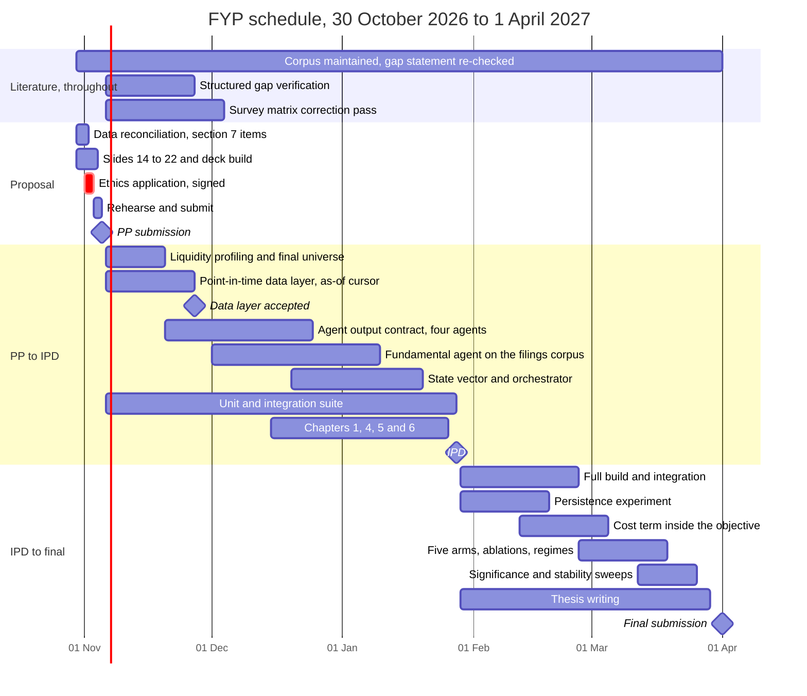

*Created 23 October 2026, for slide 17 of the PP live presentation template. The plan to 5 November is detailed and credible. Nothing in the vault goes past that date, and the rubric's plan criterion asks about the whole project, so the stages after the proposal are composed here from the module scopes rather than extracted. Sentiment is out of scope throughout.*

> [!NOTE]
> **Revised 30 October 2026.** This criterion scored **32 of 100** in the [[24-10-2026]] assessment, the lowest of the nine, described there as critical and immediately recoverable. That section carries a twenty-two item checklist and this note satisfied roughly a third of it. Three corrections and four additions follow. The dates are confirmed, the schedule is drawn, milestones have objective completion criteria, resources and costs are stated, and the boundary between proposal-stage work and full implementation is defined. **The work breakdown structure is the one checklist item deliberately not written**, recorded as open decision 5.

---

## Why this note exists

Two gaps, not one. The near-term plan exists in [[29-09-2026]] §11 at the level of individual tasks and hours, which is more than the slide needs. `[CORRECTED 30 OCTOBER 2026]` The post-proposal plan did not exist at all when this note was written, and the dates have since been confirmed. What the later stages contain still comes from the three-row table in [[16-06-2026]] §2.2.

The template's instruction is the standard to meet: a credible plan includes dependencies and fallback options, not only dates.

> [!important]
> **`[CONFIRMED 30 OCTOBER 2026]` The summative deadlines.** Supplied separately; they appear in none of the four issued documents.
>
> | Assessment | Deadline | Weight |
> |---|---|--:|
> | PP Submission, document and video presentation | **Thursday 5 November 2026** | 15% |
> | IPD, document and video demonstration | **Thursday 28 January 2027** | 15% |
> | Final submission, thesis document, video demonstration and code | **Thursday 1 April 2027** | 70% |
>
> **The viva is the part that does not reconcile.** [[16-06-2026]] §2.2 records a 50 percent report and artefact plus a 20 percent viva of up to 45 minutes. The deadline list carries one 70 percent final submission with no viva named. The arithmetic matches, so it has probably been folded in, but Part 1 below still plans viva preparation. Carried to the supervisor rather than resolved here.

---

## Part 1. The whole project, by stage

The template's four-row table, extended to five because the proposal period is still running.

| Stage | Main work | Milestone or output | Dependency |
|---|---|---|---|
| **Now to PP Submission, 5 November 2026** | Close the SE spine: questions, requirements, architecture, methodology, testing design. Run the orchestration proof of concept and capture its evidence. Build and rehearse the deck | Working core proof of concept, 21-slide deck, signed Ethics Application, recorded video | Corporate-action handling for any quoted return. Ethics form signatures |
| **PP to IPD, 6 November 2026 to 28 January 2027**, twelve weeks, about 288 hours | Adjusted price panel from the purchased registers. Filings corpus harvest. Fundamental agent built live. Full four-agent framework | **Working prototype**, which the module requires at IPD. Chapters 1, 4, 5 and 6 | Data Library delivery, lead time unknown. The filings harvest, which is independent of everything else and should start early |
| **IPD to final build**, from 29 January 2027 | Full build and integration. Cost term inside the allocation objective. The persistence re-levering experiment, which needs no CSE data | Feature-complete artefact. Sub-gap 2 converted from hypothesis to result or reported null | Architecture frozen. Bid, ask and depth if the exchange request succeeds, otherwise the proxy route stands |
| **Testing and evaluation**, inside the same nine-week window, about 216 hours in total | Five arms at full scale, all ablations, regime decomposition, significance testing, stability sweeps | Evaluation dataset and results. The CSE baseline set | A stable artefact. The adjusted panel |
| **Report and finalisation, to 1 April 2027** | Analysis, limitations, thesis, demonstration, viva preparation | **Fully functional prototype** and the whole thesis | Results complete |

The prototype expectations are the module's own, recorded at [[16-06-2026]] §2.2: no prototype required at the proposal, a working prototype at IPD, a fully functional prototype at the end.

---

## Part 1a. The schedule as a chart

`[ADDED 30 OCTOBER 2026]` §6.5 asks for a Gantt chart or equivalent, and §2.3 lists one as deliverable 10 of the fifteen required by 5 November. Nothing in this note was one.

**Three things the chart shows that the stage table does not.** The literature work runs the whole length of the project rather than finishing before the build starts. The unit and integration suite runs across the whole twelve weeks to IPD rather than sitting in one block, because the three tests that protect properties which cannot be retrofitted have to exist before the components they guard. And thesis writing runs the full nine weeks beside the build rather than following it, because nine weeks will not hold both in sequence.

> [!important]
> **`[ADDED 30 OCTOBER 2026]` The literature track is maintenance and verification, not collection, and the distinction is load-bearing.** [[24-10-2026]] records two Confirmed decisions that this bar must not appear to contradict: do not introduce another agent, research gap or research topic, and **do not continue collecting literature to raise the paper count**. The corpus is frozen at 59 reviewed papers and stays frozen.
>
> What continues is three specific things, each already outstanding rather than newly invented. The **gap statement carries a 2026-03-09 cutoff** and has to be re-checked before each submission, because a gap claim ages and an examiner is entitled to ask when it was last tested. The **structured gap verification** [[Week 4]] §2.2 asked for, comparing existing systems across aggregation method, regime detection, liquidity treatment and evaluation protocol, is matrix work on sheets that already exist. And the **374-day correction in the survey matrix** sits in roughly twenty cells across eight review notes and needs a note revision with the paper check that implies, rather than a find and replace.
>
> The one paper named as unread, a 2026 study on modular transaction-cost layers, is paywalled. If it becomes available it is read and the gap statement is re-checked against it, which is verification rather than expansion.

---

## Part 1b. Milestones, and what is true when each is met

`[ADDED 30 OCTOBER 2026]` §6.5 asks for objective milestone-completion criteria **rather than subjective progress percentages**. Each row below is a condition that is either true or false on the day. None is a percentage.

| # | Milestone | Date | What is true when it is met |
|---|---|---|---|
| **M1** | PP submission | 5 Nov 2026 | Slides submitted, **signed Ethics Application submitted**, and every §7 data inconsistency either reconciled or stated as outstanding with a reason |
| **M2** | Point-in-time data layer | 27 Nov 2026 | The as-of cursor **raises** on any row past the simulation clock rather than warning, and the cursor-violation test passes |
| **M3** | Adjusted dataset accepted | 11 Dec 2026 | Raw, rejected and accepted record counts reconcile to one auditable figure, and the raw, cleaned and final eligible universes are each defined with every exclusion explained |
| **M4** | Four agents behind one contract | 25 Dec 2026 | Every agent returns all six fields with declared types and `as_of` equal to the cursor, on one ticker-date end to end |
| **M5** | Fundamental agent live | 10 Jan 2027 | It answers from retrieved filings with every argument traceable to a retrieved figure, and **usable coverage measured against a probe set** rather than assumed |
| **M6** | Orchestrator responds to state | 20 Jan 2027 | Acceptance criterion **A3** passes: the weight vector measurably responds to liquidity with the rest held fixed, with the sensitivity sweep plotted |
| **M7** | IPD | 28 Jan 2027 | A working prototype, **every Must requirement has a test that runs**, and chapters 1, 4, 5 and 6 drafted |
| **M8** | Feature complete | 26 Feb 2027 | No Must requirement untested. The cost term sits **inside** the allocation objective rather than being deducted after it |
| **M9** | Evaluation complete | 19 Mar 2027 | Five arms over byte-identical cached agent outputs, all ablations, regime decomposition, and the diagnostics reported **whether or not they are favourable** |
| **M10** | Final submission | 1 Apr 2027 | Thesis, artefact and code submitted, and the pipeline reproducible from a clean environment |

**M2 and M6 are the two that cannot slip.** The cursor cannot be retrofitted, and A3 is the acceptance criterion the whole contribution rests on, which is why it sits eight days before IPD rather than on it.

---

## Part 1c. Resources, tools and costs

`[ADDED 30 OCTOBER 2026]` §6.5 asks for required datasets, tools, computing resources and financial costs. The note had none of this.

| Resource | Position | Cost |
|---|---|---|
| Market data | CSE Data Library, forty items, **purchased at the student rate** | Paid, one-off, already incurred |
| Filings corpus | 22,893 documents harvested from the announcements feed | None beyond storage |
| Bid, ask and depth | Requested from the exchange, unanswered | Unknown. **The proxy route is the plan and needs none** |
| Compute | Local machine. The orchestrator is a low-capacity form rather than a network, and agents execute once per run with five arms consuming cached outputs, so a five-arm comparison costs one agent pass rather than five | None |
| Model backbone, fundamental agent | Open against four selection criteria. **The one line item that could carry a real cost.** A local open-weight model is the zero-cost fallback and bounds the exposure | Unknown, bounded by the fallback |
| Software | Python and the scientific stack, Zotero with Better BibTeX, Obsidian | None |
| Time | Zero hours Monday, two Tuesday to Friday, four Saturday, twelve Sunday. About **22 hours to PP submission**, **288 hours** across the twelve weeks to IPD, **216 hours** across the nine weeks to final submission | The binding constraint |

**Time is the only binding constraint.** Nothing in this plan is blocked on money, compute or licensing, and that is worth saying because it means every risk in [[18 Risk, Mitigation and Contingency]] is a schedule risk or a research risk rather than a procurement one.

---

## Part 2. The proposal period in detail

126 hours from 29 September to 5 November, adopted as a revised plan after the earlier 182-hour version. Availability is zero on Mondays, two hours Tuesday to Friday, four on Saturday and twelve on Sunday.

| Date | Gate |
|---|---|
| 4 Oct | Research records synchronised, literature and gap frozen |
| 11 Oct | Questions, objectives, requirements, data schema and experimental universe frozen |
| 18 Oct | Architecture and methodology defined, integrated proof-of-concept skeleton working. **Change freeze: no new agents, datasets, research gaps or technologies after this date** |
| 25 Oct | Adaptive orchestration proof of concept with baseline and ablation evidence working |
| 1 Nov | Full slide deck, ethics, backups and proof of concept frozen |
| 5 Nov | Submission complete |

> [!important]
> **`[SUPERSEDED 30 OCTOBER 2026]` The 25 October gate was voided by instruction, not missed.** [[24-10-2026]] §2.1 sets aside implementation, coding, model development, experimentation and proof-of-concept work until 5 November, recorded as **Final**. The adaptive orchestration proof of concept with baseline and ablation evidence therefore did not run and was not meant to. The 1 November and 5 November gates stand.
>
> Presenting the table unchanged would show a plan that ignored an instruction. Presenting the instruction shows a plan that responded to one, which is what the criterion rewards.

**Honest status against those gates.** The 4 October and 11 October gates were partly met on the research side and not on the software engineering side: the questions, requirements, architecture and methodology were scheduled for 6 to 17 October and were written on 23 October instead. The 18 October build did not start from the position the spec assumed, which is why [[PoC Build Plan]] re-cut it to 36 hours and dropped the persistence experiment. That slippage is recorded rather than smoothed over, and it belongs on this slide as evidence that the plan is monitored rather than decorative.

---

## Part 2a. The boundary between proposal-stage work and full implementation

`[ADDED 30 OCTOBER 2026]` The last item on the §6.5 checklist. The 24 October instruction makes this clean rather than awkward.

| At the proposal | After 5 November |
|---|---|
| The mechanism is **described**: a specified weighting form, a complete requirements set, an architecture with one interface fully specified, and a stated experimental design | The mechanism is **built**: data layer, agents behind the contract, orchestrator, five-arm harness |
| Feasibility is **evidenced from work already done**: the verified data pipeline, the secured filings corpus, the adjusted panel, the measured liquidity cross-section | Feasibility is **demonstrated**: the sixteen-item proof-of-concept specification in [[24-10-2026]] §8 |
| Claims are bounded by what the design can carry | Claims are bounded by what the run produced |

The supervisor's position, stated twice in the 24 October email, is that completion is not required by the deadline, **only its design**. The rule attached to it governs every slide in the deck: *do not present planned work as completed work.*

---

## Part 3. Critical path and dependencies

| Dependency | Blocks | Status |
|---|---|---|
| Corporate-action adjusted price series | Every return, and therefore every agent output, every arm comparison and every number in the evaluation | `[CLEARED 30 OCTOBER 2026]` **Built 23 October**, carrying `adj_close` and `tr_close` with 31 register corrections. `tr_close` is primary against ASTRI. The detect-and-exclude workaround is withdrawn. The residual constraint is **DR10**: no documented date is an ex-date, and 259 events are marked approximate |
| The as-of cursor before any agent | Point-in-time correctness, which cannot be retrofitted | The one ordering rule the build protects |
| Filings corpus harvest | The fundamental agent, and therefore the heterogeneity claim | `[CLEARED 30 OCTOBER 2026]` **Secured.** 22,893 documents, 2012-01-01 to 2026-10-04, roughly 340 counters, every filename prefixed with the CSE announcement date so the as-of cursor filters on publication. What remains is the build, and a probe set to measure usable coverage |
| Bid, ask and depth from the exchange | The microstructure route, the tick-size classification, and a measured spread | Requested, unanswered. Declared fallback is the proxy route, which was bounded in advance |
| Agents cached before the arms run | The fairness rule, and acceptance criterion A5 | Architectural, designed in |
| Ethics signatures | The entire proposal mark, as a qualifying condition | Scheduled for 1 November |

**The one explicitly unblocked path.** The persistence experiment runs on a published paper's own four-ETF environment and needs no CSE data at all, which takes that sub-gap off the critical path entirely. It was cut from the proposal period for time rather than for dependency, and it is the natural first task after submission.

---

## Part 4. Fallbacks

The template asks for fallback options rather than dates alone, and these were declared in advance rather than invented after a failure.

| If this fails | Fallback |
|---|---|
| Bid, ask and depth never arrive | The two-level data plan declared at [[29-09-2026]] §7.8. Level A, proxy-based liquidity from volume, zero-volume frequency, zero-return frequency, turnover and Amihud, is guaranteed feasible. Level B is the enhancement, not the plan |
| The adjusted series is late | Detect and exclude, selecting proof-of-concept counters with no detected corporate-action event in the window, with the exclusion count and the direction of bias reported |
| The fundamental agent is unbuildable in time | Stub it against a probe set while keeping it emitting the contract, so the on-and-off ablation still runs, and report it as stubbed |
| The weights turn out inert | This is a finding rather than a build failure. Report the sensitivity sweep and investigate whether it is the form, the scaling or the state. A3 is deliberately scheduled early so there is time to respond |
| The universe collapses after the liquidity screen | The surviving count is itself a result. Run on what survives and report the screen |
| The persistence estimator is unstable on short windows | Per-regime estimation and a slower-moving cap, with the instability reported either way |
| Honest significance testing returns nothing | Decided in advance that this is acceptable. A reviewed portfolio framework runs 16 folds with the same tests and finds no significant mean-return outperformance anywhere |

---

## Part 5. How the plan is tracked

Worth one line, because the criterion assesses realism and a tracked plan is more credible than a drawn one.

A task-level tracker covering the proposal period holds 193 atomic tasks against 126 planned hours, with per-task date, workstream, output, dependency, priority, status, completion, a quality rating and an evidence field, plus a 4.5 out of 5 threshold that flags completed tasks below it for rework. Separate sheets carry weekly milestones, a priority improvement log, deliverable definitions of done, and post-deadline live presentation preparation.

> [!NOTE]
> The tracker's own status fields are stale, since it was built on 29 September and the work since has been recorded in the vault notes rather than in the sheet. Either refresh it before the slide is built or present the plan from the notes, but do not present a tracker showing zero completed tasks.

---

## Part 6. Open decisions

`[UPDATED 30 OCTOBER 2026]`

1. ~~The dates after 5 November.~~ **Closed 30 October.** IPD 28 January 2027, final submission 1 April 2027. **The viva remains open**: the proforma carries a 20 percent viva of up to 45 minutes, the deadline list carries one 70 percent final submission with no viva named. Carried to the supervisor.
2. **Whether the slippage in Part 2 is shown.** My reading is yes, briefly, because a plan presented as fully on track invites a question that a plan presented with a recorded deviation does not. The criterion rewards realism.
3. **Whether the tracker is refreshed or retired.** A stale tracker is worse than no tracker on a slide.
4. **Whether the proposal period appears at all**, given that by the presentation it will be nearly complete. It is probably one row rather than the six-gate table.
5. `[RAISED 30 OCTOBER 2026]` **The work breakdown structure.** §6.5 asks for work packages decomposed into measurable tasks with estimated duration and effort, plus dependencies between packages. Part 1a gives the schedule and Part 1b the milestones; the task-level decomposition beneath them is not written. **Deferred on 30 October for time, not because it is unnecessary**, and it is the largest remaining gap against that checklist.

---

**Related notes.** [[29-09-2026]] §11 for the full task-level plan. [[PoC Build Plan]] for the re-cut build and what was dropped. [[18 Risk, Mitigation and Contingency]] for the risks these fallbacks answer. [[16-06-2026]] §2.2 for the module stage scopes.

**Language discipline applies here too.** Dates not yet confirmed are marked as such rather than estimated.
